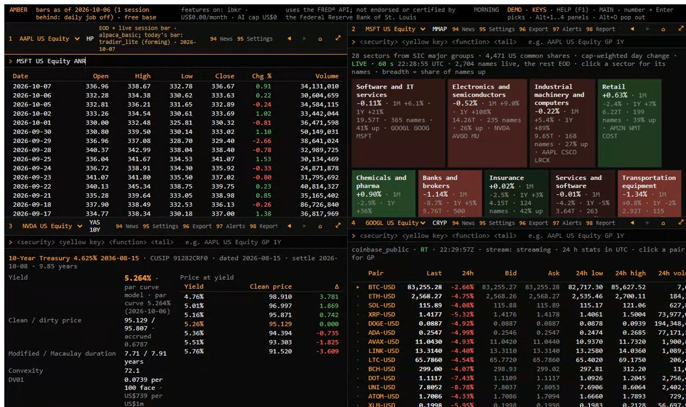

# Amber — a local-first market terminal

Amber is a keyboard-driven market workstation modelled on professional terminal workflows. It covers equities, fixed income, FX, commodities, crypto and macro, and runs entirely on one Windows 11 machine using free and low-cost data sources.

This repository is a public overview of a private project. Source code, data and credentials are not published. Market-data licences restrict redistribution, and the system is built for a single user.

Author: [@maren-epochs](https://github.com/maren-epochs)

## Demos

| Demo | Link |
|---|---|
| Mobile walkthrough: 14 functions, one per second, simulated data | [maren-epochs.github.io/amber-terminal](https://maren-epochs.github.io/amber-terminal/) |
| Desktop screen recording of the real terminal: 1:42, 97 commands (recorded 26 Oct 2026) | [maren-epochs.github.io/amber-terminal/desktop](https://maren-epochs.github.io/amber-terminal/desktop/) |

[](https://maren-epochs.github.io/amber-terminal/desktop/)

## At a glance

| Measure | Value |
|---|---|
| Build period | 22 Sep – 7 Oct 2026 (about two weeks), 800+ commits |
| Backend | 32,500 lines of Python (FastAPI, DuckDB, Polars, PyArrow) |
| Frontend | 8,600 lines of TypeScript/React |
| Verification code | 6,200 lines of pytest (415 tests) + 3,300 lines of check and sweep tools |
| Terminal functions | 122 commands (chart, description, financials, screens, curves, news, calendars, analytics) |
| Data sources | 96 declared sources, each with licence and AI-use flags |
| AI interface | MCP server with 60+ tools for Claude Code / Claude Desktop |
| Exit tests | 16 of 16 gated tests pass; 2 trading gates deferred by design |

## What it does

The UI is a multi-panel terminal. You type a security plus a function code, for example `MSFT US Equity GP` for a price chart or `DES` for a company description. Each panel keeps its own history, and layouts persist between sessions.

| Area | Examples |
|---|---|
| Equities | Candlestick charts down to 1-minute bars, financial statements from SEC XBRL, estimates, holders, insiders, short interest, index membership and contribution |
| Screening and research | Screener over the US universe, factor backtests with point-in-time membership and fundamentals, a SQL-style query language over the data lake |
| Fixed income | Treasury yield/price math (duration, convexity, DV01), yield curves, a SOFR swap curve, world government bonds, TRACE corporate-bond activity, CDS |
| Derivatives | Option chains and valuation, volatility indices, futures curves and settlements |
| Macro and commodities | Economic calendar and releases with point-in-time vintages, central banks, WASDE, crop progress, energy, weather |
| News | Aggregated headlines with source fences, article reader, most-read topics |
| Live data | Real-time US trades and quotes where a free feed allows it, crypto streams, intraday VWAP and volume profiles |

## Architecture

```
React terminal (dockview panels, lightweight-charts, Perspective grids)
        │  HTTP + WebSocket, localhost only, per-start session token
FastAPI gateway  ── response cache, background warm-up, provider health and circuit breakers
        │
Core modules (~100)  ── analytics, screens, curves, backtests, news, calendars
        │
Parquet data lake + DuckDB  ── facts store, bars, filings, vendor-partitioned
        │
Provider adapters  ── rate-limited, feature-flagged (SEC EDGAR, FRED, FINRA, Treasury,
                      broker market data, exchange settlements, public crypto feeds, …)

Side channels: MCP server (AI tools) · Python client + Excel UDFs · JupyterLab notebooks
Scheduled jobs: daily ingest, nightly backup with restore drill, post-close checks
```

## Engineering decisions worth noting

**Facts, not loose numbers.** Every value is a `Fact` record: entity, metric, period, value, unit, scale, as-of time, source and delay class, with a stable ID. AI answers cite fact IDs, and code renders the numbers, so an AI assistant cannot invent a figure without the check catching it.

**Licence fences in configuration.** Each source declares whether its data may be sent to an AI model and whether caches must be purged on termination. The default is deny.

**Paid data off by default.** Every paid feed sits behind a feature flag. Adapters are built and tested before a flag is turned on, and the CLI reports the monthly cost of the enabled set.

**Point-in-time correctness.** Backtests use index membership as filed and fundamentals as first reported. Macro series carry their first-release timestamps. This keeps look-ahead bias out of research results.

**Measured, not assumed, performance.** Latency budgets come from the plan: a command's first render under 1.5 s at p95 and a cached render under 150 ms. An exit-test harness times all 95 routes. Bottlenecks get profiled and fixed at the cause. Two recent examples:
- A vendor rate limiter was sleeping between batched quote calls. Reading the vendor's actual limit from response headers and running the batches in parallel cut a 2.9 s call to 0.3 s.
- A backtest was opening a full query-engine connection just to list 102 index members. Reading those files directly cut the lookup from 3.5 s to 5 ms.

**Local-only security.** The API binds to 127.0.0.1, every write requires a per-start session token, only the terminal's own origin may open WebSockets, and secrets live in Windows Credential Manager.

## Verification

| Check | What it covers |
|---|---|
| pytest (415 tests) | Units, providers, API routes, and pricing reference cases checked against QuantLib |
| End-to-end (32 flows) | Real command flows in headless Edge via Playwright, including memory and owner-state guards |
| Exit tests | Plan-level gates: latency budgets, FA golden-set mismatch rate (0.40% vs 2% gate), option values inside the broker's bid-ask (≥95%), AI analyst accuracy and abstention, swap-curve self-repricing (0.0000 bp) |
| Data-quality reports | Daily gap checks and cross-checks between independent sources (closes, dividends, rates, FX) |
| Fuzzing and sweeps | Every route and MCP tool run with unusual inputs, every security function across asset types, every documented example command |
| Backup | Nightly backup followed by an automated restore drill |

## AI integration

- **MCP server.** It exposes the terminal's data and analytics as 60+ tools, so an AI assistant can answer questions from cited facts rather than from memory.
- **Built-in AI analyst.** It is evaluated on a graded question set: 100% correct on 125 answerable questions, 100% correct abstention on 25 unanswerable ones, and zero numbers not bound to a fact.
- **Command bar.** A natural-language command bar resolves typed intent to exact commands, at 97% exact match on a 200-case evaluation set.

## How it was built

One developer, using Claude Code as an AI pair programmer. The work followed a written, source-verified plan: vendor prices, limits and licences were checked against primary pages, with access dates. Progress ran through a build log, explicit owner decisions and gated exit tests. My role covered the product definition, data-source and licence decisions, architecture direction, and review and acceptance of every gate.

## Stack

Python 3.13 · FastAPI · Uvicorn · DuckDB · Polars · PyArrow · NumPy · QuantLib (reference tests) · React · TypeScript · Vite · dockview · lightweight-charts · Perspective · Playwright · MCP · JupyterLab · Windows Task Scheduler · PowerShell

## Notes

Amber is a personal project and is not affiliated with or endorsed by any market-data vendor or terminal provider. Function codes follow widely used terminal conventions for familiarity. No market data is redistributed here.
